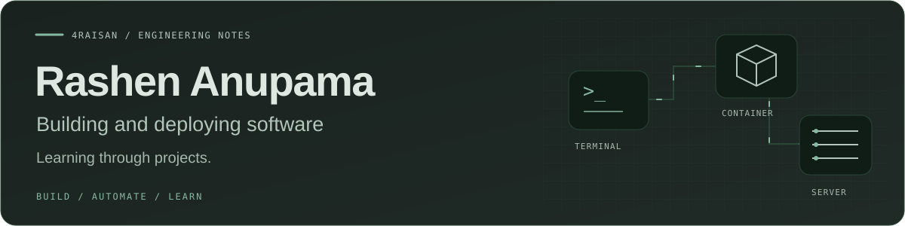
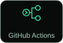
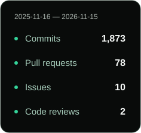

<picture>
  <source media="(max-width: 600px)" srcset="assets/header-mobile.svg">
  <source media="(prefers-reduced-motion: reduce)" srcset="assets/header-static.svg">
  
</picture>

I build **web applications and developer tools** in Sri Lanka. I’m especially interested in how software gets tested, deployed and kept running.

[Email me](mailto:mn4raisan@gmail.com) · [Browse my repositories](https://github.com/4Raisan?tab=repositories)

## 🚀 Featured projects

| Project | What you can do |
| --- | --- |
| **[Luxora](https://github.com/4Raisan/Luxora)** | Book a home service and follow it from request to fulfillment. Under the hood, pull requests run checks based on the files they change. [Visit Luxora](https://luxora.bond) · [Architecture](https://4raisan.github.io/Luxora/architecture/) · [CI workflow](https://github.com/4Raisan/Luxora/blob/main/.github/workflows/ci.yml) |
| **[Quick Drop 11](https://github.com/4Raisan/Quick-Drop-11)** | Move text, images or PDFs between devices with a **four-digit code**. Shares expire after 11 hours. [Try it](https://quickdrop11.vercel.app/) |
| **[CodeWeb](https://github.com/4Raisan/CodeWeb)** | Explore the relationships in a codebase as an **interactive graph**. The browser viewer fits in a single file. |

More projects

| Project | What it is |
| --- | --- |
| [OmniView](https://github.com/4Raisan/OmniView) | Offline desktop viewer for PDFs, documents, spreadsheets and media, released for Windows, Linux and macOS |
| [NetCroc](https://github.com/4Raisan/NetCroc) | Desktop network monitor with live speeds, usage history and optional VPN tools |
| [YakKeeper](https://github.com/4Raisan/YakKeeper) | Project discovery and collaboration hub with GitHub sign-in and team task boards |
| [Sparkle](https://github.com/4Raisan/Sprinkle) | Car wash marketplace MVP on Next.js, Prisma and Neon PostgreSQL |

## 🛠 Technologies I use

  
  
  
  

## 🌱 Open source

**Floci** · Fixed [tag propagation in nested CloudFormation stacks](https://github.com/floci-io/floci/pull/7383), [DynamoDB global-table billing](https://github.com/floci-io/floci/pull/7931) and [S3 multipart upload pagination](https://github.com/floci-io/floci/pull/6981). [All merged PRs](https://github.com/floci-io/floci/pulls?q=is%3Apr+is%3Amerged+author%3A4Raisan)

**xerj** · Fixed [range validation in the console](https://github.com/xerj-org/xerj/pull/2607). [All merged PRs](https://github.com/xerj-org/xerj/pulls?q=is%3Apr+is%3Amerged+author%3A4Raisan)

### GitHub activity

  
  <picture>
    <source media="(prefers-reduced-motion: reduce)" srcset="assets/calendar.svg">
    
  </picture>

<!-- activity-date -->Updated 2026-11-24 15:23 Sri Lanka time (UTC+05:30)<!-- /activity-date --> · [Profile maintenance](MAINTENANCE.md)
