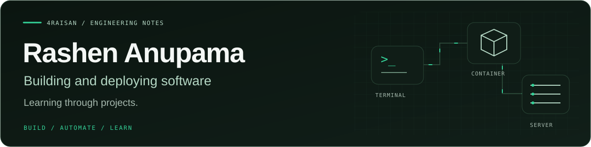
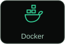
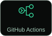
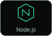
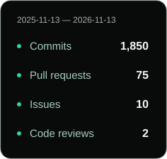

<picture>
  <source media="(max-width: 600px)" srcset="assets/header-mobile.svg">
  <source media="(prefers-reduced-motion: reduce)" srcset="assets/header-static.svg">
  
</picture>

**Rashen Anupama** · IT undergraduate at SLTC Research University, Sri Lanka

I build and deploy web applications and desktop tools. I use containers, CI, and managed databases in my projects, and I’m working toward cloud infrastructure and platform engineering.

[Email](mailto:mn4raisan@gmail.com) · [All repositories](https://github.com/4Raisan?tab=repositories)

### Selected work

[**Luxora ↗**](https://github.com/4Raisan/Luxora_v1) · [live site](https://luxora.bond)

Home-concierge platform with customer, provider and administrator roles. React, Express, Prisma and PostgreSQL, with access and KYC checks enforced on the server. Frontend on Vercel, backend container on Northflank, database on Supabase.

- **Infrastructure:** [container build](https://github.com/4Raisan/Luxora_v1/blob/main/Dockerfile) · [CI runs](https://github.com/4Raisan/Luxora_v1/actions/workflows/ci.yml) · [Cloud Run implementation and rollout plan](https://github.com/4Raisan/Luxora_v1/blob/main/docs/SERVERLESS_ARCHITECTURE.md)
- **Access control:** [auth middleware](https://github.com/4Raisan/Luxora_v1/blob/main/backend/src/middleware/auth.js)
- **Design:** [architecture explorer](https://4raisan.github.io/Luxora_v1/architecture/) · [knowledge graph](https://4raisan.github.io/Luxora_v1/)

[**YakKeeper ↗**](https://github.com/4Raisan/YakKeeper) · [live site](https://yakkeeper.vercel.app/)

Project discovery and collaboration hub. Next.js and Supabase, with GitHub sign-in, owner and member permissions, team task boards and administrator moderation.

- [Setup and deployment](https://github.com/4Raisan/YakKeeper#deploy-your-own-instance) · [Security policy](https://github.com/4Raisan/YakKeeper/blob/main/.github/SECURITY.md)

[**Quick Drop 11 ↗**](https://github.com/4Raisan/Quick-Drop-11) · [live site](https://quickdrop11.vercel.app/)

Temporary text, image and PDF sharing between devices. Node.js and Supabase, with four-digit share IDs, direct uploads, signed download links and 11-hour expiry.

- [Architecture](https://github.com/4Raisan/Quick-Drop-11/blob/master/docs/ARCHITECTURE.md) · [Deployment and maintenance](https://github.com/4Raisan/Quick-Drop-11/blob/master/docs/OPERATIONS.md)

### Also built

| Project | What it is |
| --- | --- |
| [OmniView](https://github.com/4Raisan/OmniView) | Offline desktop viewer for PDFs, documents, spreadsheets and media, released for Windows, Linux and macOS |
| [NetCroc](https://github.com/4Raisan/NetCroc) | Desktop network monitor with live speeds, usage history and optional VPN tools |
| [CodeWeb](https://github.com/4Raisan/CodeWeb) | Single-file codebase graph explorer that runs in the browser |
| [Sprinkle](https://github.com/4Raisan/Sprinkle) | Car wash marketplace MVP branded Sparkle on Next.js, Prisma and Neon PostgreSQL |

### Open source

- **Floci** (8 merged PRs): [propagate tags to nested CloudFormation stacks](https://github.com/floci-io/floci/pull/7383) and [fix S3 multipart upload pagination](https://github.com/floci-io/floci/pull/6981).
- **xerj** (3 merged PRs): [fix console range validation](https://github.com/xerj-org/xerj/pull/2607).

### Tools used in these projects

  
  
  
  

**In the repositories above:** Docker, GitHub Actions, Node.js, PostgreSQL, Prisma, React, Next.js, TypeScript, Python, Supabase, Vercel.

**Learning next:** AWS, Terraform, Kubernetes and IAM.

### GitHub activity

  
  <picture>
    <source media="(prefers-reduced-motion: reduce)" srcset="assets/calendar.svg">
    
  </picture>

<!-- activity-date -->Updated 2026-11-13 12:14 Sri Lanka time (UTC+05:30)<!-- /activity-date --> · [Profile maintenance](MAINTENANCE.md)
