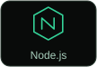

<picture>
  <source media="(max-width: 600px)" srcset="assets/header-mobile.svg">
  <source media="(prefers-reduced-motion: reduce)" srcset="assets/header-static.svg">
  
</picture>

I build **web applications and developer tools**, with a focus on cloud infrastructure and CI. [Contact me](mailto:mn4raisan@gmail.com) · [Browse repositories](https://github.com/4Raisan?tab=repositories)

**Inside the build** · Customers book services, providers manage requests, and administrators oversee the platform. Pull requests run checks for the files they change. Scheduled builds run the full suite.

**[Visit Luxora ↗](https://luxora.bond)** · [Explore the architecture](https://4raisan.github.io/Luxora/architecture/) · [Read the CI workflow](https://github.com/4Raisan/Luxora/blob/main/.github/workflows/ci.yml)

## Open source

| Upstream | What I fixed | Merged work |
| --- | --- | --- |
| **Floci** | Tag propagation to nested CloudFormation stacks | [PR #7383](https://github.com/floci-io/floci/pull/7383) |
| **Floci** | Billing mode for DynamoDB global tables | [PR #7931](https://github.com/floci-io/floci/pull/7931) |
| **Floci** | Pagination for S3 multipart uploads | [PR #6981](https://github.com/floci-io/floci/pull/6981) |
| **xerj** | Range validation in the console | [PR #2607](https://github.com/xerj-org/xerj/pull/2607) |

All merged contributions · [Floci](https://github.com/floci-io/floci/pulls?q=is%3Apr+is%3Amerged+author%3A4Raisan) · [xerj](https://github.com/xerj-org/xerj/pulls?q=is%3Apr+is%3Amerged+author%3A4Raisan)

## Selected tools

| **Quick Drop 11** | **CodeWeb** |
| --- | --- |
| Share text, images and PDFs between devices with a **four-digit code**. Shares expire after 11 hours. | Explore a codebase as an **interactive graph** in your browser. The viewer fits in a single file. |
| [Try Quick Drop ↗](https://quickdrop11.vercel.app/) · [Source](https://github.com/4Raisan/Quick-Drop-11) | [Explore CodeWeb ↗](https://github.com/4Raisan/CodeWeb) |

### Also built

| Project | What it is |
| --- | --- |
| [OmniView](https://github.com/4Raisan/OmniView) | Offline desktop viewer for PDFs, documents, spreadsheets and media, released for Windows, Linux and macOS |
| [NetCroc](https://github.com/4Raisan/NetCroc) | Desktop network monitor with live speeds, usage history and optional VPN tools |
| [YakKeeper](https://github.com/4Raisan/YakKeeper) | Project discovery and collaboration hub with GitHub sign-in and team task boards |
| [Sparkle](https://github.com/4Raisan/Sprinkle) | Car wash marketplace MVP on Next.js, Prisma and Neon PostgreSQL |

### Tools used in these projects

  
  
  
  

**Learning next:** AWS, Terraform, Kubernetes and IAM.

### GitHub activity

  
  <picture>
    <source media="(prefers-reduced-motion: reduce)" srcset="assets/calendar.svg">
    
  </picture>

<!-- activity-date -->Updated 2026-11-24 15:23 Sri Lanka time (UTC+05:30)<!-- /activity-date --> · [Profile maintenance](MAINTENANCE.md)
