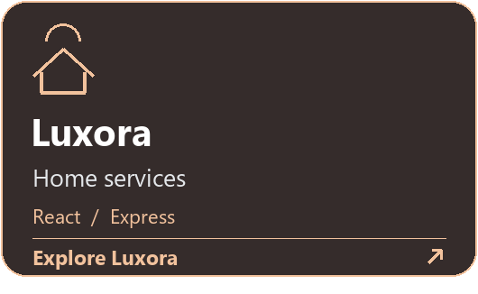
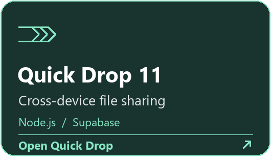
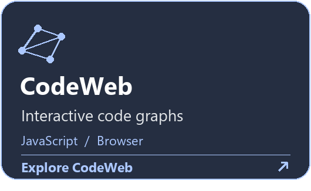
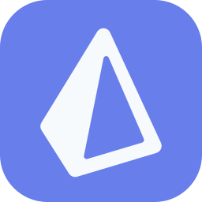

<picture>
  <source media="(max-width: 600px)" srcset="assets/header-mobile.svg">
  <source media="(prefers-reduced-motion: reduce)" srcset="assets/header-static.svg">
  
</picture>

## 🚀 Featured projects

Source code &amp; more projects

[Luxora source](https://github.com/4Raisan/Luxora) · [Quick Drop source](https://github.com/4Raisan/Quick-Drop-11) · [CodeWeb source](https://github.com/4Raisan/CodeWeb)

| Project | What it is |
| --- | --- |
| [OmniView](https://github.com/4Raisan/OmniView) | Offline desktop viewer for PDFs, documents, spreadsheets and media, released for Windows, Linux and macOS |
| [NetCroc](https://github.com/4Raisan/NetCroc) | Desktop network monitor with live speeds, usage history and optional VPN tools |
| [YakKeeper](https://github.com/4Raisan/YakKeeper) | Project discovery and collaboration hub with GitHub sign-in and team task boards |
| [Sparkle](https://github.com/4Raisan/Sprinkle) | Car wash marketplace MVP on Next.js, Prisma and Neon PostgreSQL |

🎓 IT undergraduate at SLTC, Sri Lanka · Building web apps and developer tools · Exploring platform engineering

## 🧰 Toolbox

               

**Coding agents** · Claude Code · Antigravity · Codex

Stack by category

- **Languages** · Python, Java, JavaScript, TypeScript, PowerShell, SQL
- **Applications & data** · React, Next.js, Node.js, Express, Prisma, PostgreSQL, Supabase
- **Delivery** · Docker, GitHub Actions, Vercel, Git

## 🌱 Open source

- **Floci** · [CloudFormation tags](https://github.com/floci-io/floci/pull/7383) · [DynamoDB billing](https://github.com/floci-io/floci/pull/7931) · [S3 pagination](https://github.com/floci-io/floci/pull/6981)
- **xerj** · [Console range validation](https://github.com/xerj-org/xerj/pull/2607)

## 🔥 GitHub activity

  

  <picture>
    <source media="(prefers-reduced-motion: reduce)" srcset="assets/calendar.svg">
    
  </picture>

## Connect

 

<!-- activity-date -->Updated 2026-11-25 03:55 Sri Lanka time (UTC+05:30)<!-- /activity-date --> · [Profile maintenance](MAINTENANCE.md)
