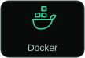

<picture>
  <source media="(max-width: 600px)" srcset="assets/header-mobile.svg">
  <source media="(prefers-reduced-motion: reduce)" srcset="assets/header-static.svg">
  
</picture>

**Rashen Anupama** · IT undergraduate at SLTC Research University, Sri Lanka

I build and deploy web applications and desktop tools. I use containers, CI, and managed databases in my projects, and I’m working toward cloud infrastructure and platform engineering.

[Email](mailto:mn4raisan@gmail.com) · [All repositories](https://github.com/4Raisan?tab=repositories)

### [Luxora](https://github.com/4Raisan/Luxora)

Luxora is a home-concierge platform for customers, providers and administrators. Its Express backend runs in a container on Northflank and stores data in PostgreSQL. On pull requests, CI selects checks based on which files changed. Scheduled runs request the full suite.

[Live site](https://luxora.bond) · [CI workflow](https://github.com/4Raisan/Luxora/blob/main/.github/workflows/ci.yml) · [Architecture explorer](https://4raisan.github.io/Luxora/architecture/)

### Open source

- **Floci** — [Fixed tag propagation to nested CloudFormation stacks](https://github.com/floci-io/floci/pull/7383), [DynamoDB global-table billing mode](https://github.com/floci-io/floci/pull/7931), and [S3 multipart upload pagination](https://github.com/floci-io/floci/pull/6981). [Merged contributions](https://github.com/floci-io/floci/pulls?q=is%3Apr+is%3Amerged+author%3A4Raisan)
- **xerj** — [Fixed console range validation](https://github.com/xerj-org/xerj/pull/2607). [Merged contributions](https://github.com/xerj-org/xerj/pulls?q=is%3Apr+is%3Amerged+author%3A4Raisan)

### Selected tools

- [Quick Drop 11](https://github.com/4Raisan/Quick-Drop-11) lets you share text, images and PDFs between devices with a four-digit ID. Shares expire after 11 hours. [Try it](https://quickdrop11.vercel.app/)
- [CodeWeb](https://github.com/4Raisan/CodeWeb) is a single-file tool for exploring a codebase as a graph in your browser.

### Also built

| Project | What it is |
| --- | --- |
| [OmniView](https://github.com/4Raisan/OmniView) | Offline desktop viewer for PDFs, documents, spreadsheets and media, released for Windows, Linux and macOS |
| [NetCroc](https://github.com/4Raisan/NetCroc) | Desktop network monitor with live speeds, usage history and optional VPN tools |
| [YakKeeper](https://github.com/4Raisan/YakKeeper) | Project discovery and collaboration hub with GitHub sign-in and team task boards |
| [Sparkle](https://github.com/4Raisan/Sprinkle) | Car wash marketplace MVP on Next.js, Prisma and Neon PostgreSQL |

### Tools used in these projects

  
  
  
  

**In the repositories above:** Docker, GitHub Actions, Node.js, PostgreSQL, Prisma, React, Next.js, TypeScript, Python, Supabase, Vercel.

**Learning next:** AWS, Terraform, Kubernetes and IAM.

### GitHub activity

  
  <picture>
    <source media="(prefers-reduced-motion: reduce)" srcset="assets/calendar.svg">
    
  </picture>

<!-- activity-date -->Updated 2026-11-24 15:23 Sri Lanka time (UTC+05:30)<!-- /activity-date --> · [Profile maintenance](MAINTENANCE.md)
