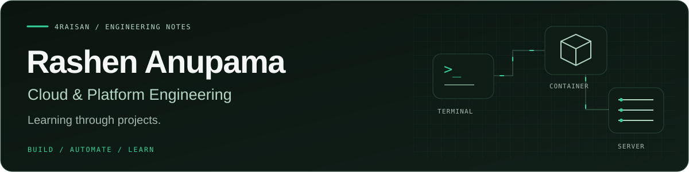
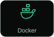
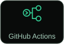
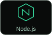
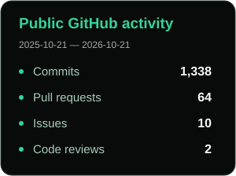
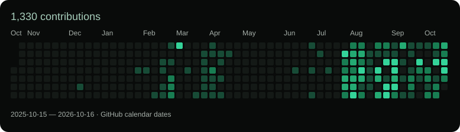

<picture>
  <source media="(max-width: 600px)" srcset="assets/header-mobile.svg">
  <source media="(prefers-reduced-motion: reduce)" srcset="assets/header-static.svg">
  
</picture>

**Rashen Anupama · Cloud & Platform Engineering**  
IT undergraduate at SLTC Research University.  
Building web applications and practical tools for everyday tasks. 
Moving toward cloud infrastructure, automation, and IAM.

### Selected work

[**Luxora ↗**](https://github.com/4Raisan/Luxora_v1)

Home-concierge platform built with React, Express, Prisma and PostgreSQL. Customer, provider and administrator roles, with server-side access and KYC checks. Frontend hosted on Vercel, backend on Northflank and database on Supabase.

[Live site](https://luxora.bond) · [Architecture explorer](https://4raisan.github.io/Luxora_v1/architecture/) · [Knowledge graph](https://4raisan.github.io/Luxora_v1/)

[Container build](https://github.com/4Raisan/Luxora_v1/blob/main/Dockerfile) · [CI and current results](https://github.com/4Raisan/Luxora_v1/actions/workflows/ci.yml) · [Access checks](https://github.com/4Raisan/Luxora_v1/blob/main/backend/src/middleware/auth.js)

[**YakKeeper ↗**](https://github.com/4Raisan/YakKeeper)

Project discovery and collaboration hub built with Next.js and Supabase. GitHub sign-in, owner and member permissions, team task boards and administrator moderation. Joining a project does not grant GitHub repository access.

[Live site](https://yakkeeper.vercel.app/) · [Setup and deployment](https://github.com/4Raisan/YakKeeper#deploy-your-own-instance) · [Security policy](https://github.com/4Raisan/YakKeeper/blob/main/.github/SECURITY.md)

[**Quick Drop 11 ↗**](https://github.com/4Raisan/Quick-Drop-11)

Temporary text, image and PDF sharing between devices, built with Node.js and Supabase. Four-digit share IDs, uploads up to 5 MB and 11-hour expiry, with direct uploads, signed download links and retry handling. The sharing feed is public.

[Live site](https://quickdrop11.vercel.app/) · [Architecture](https://github.com/4Raisan/Quick-Drop-11/blob/master/docs/ARCHITECTURE.md) · [Deployment and maintenance](https://github.com/4Raisan/Quick-Drop-11/blob/master/docs/OPERATIONS.md)

### Tools used in these projects

  
  
  
  

These tools reflect work in the repositories above. Cloud infrastructure and IAM are the direction I’m developing toward; the project links show what I’ve built so far.

### GitHub activity

  
  <picture>
    <source media="(prefers-reduced-motion: reduce)" srcset="assets/calendar.svg">
    
  </picture>

Public activity snapshot, refreshed every six hours. The original Platane snake is refreshed alongside the public statistics. Calendar dates come directly from GitHub; backdated contributions appear after GitHub processes them. <!-- activity-date -->Updated 2026-10-26 10:15 Sri Lanka time (UTC+05:30)<!-- /activity-date -->. Activity counts describe participation, not skill level.

### Contact

[Email me](mailto:mn4raisan@gmail.com) · [Browse my repositories](https://github.com/4Raisan?tab=repositories)

[Profile maintenance](MAINTENANCE.md)
